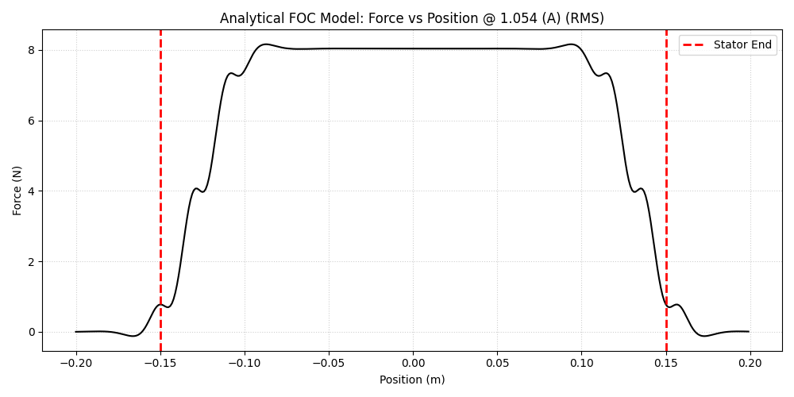
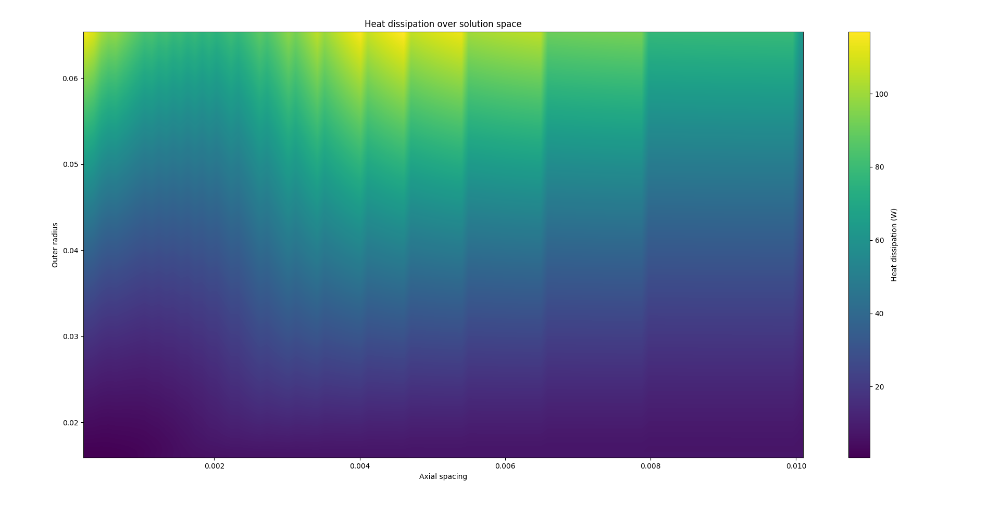

### 01_simulations

#### [00_magnetic](./00_magnetic/readme.md) — Magnetic Model

  
  
<em>1D field approximation and FOC showing position (linear) vs force (linear).</em>

---

#### [01_thermal](./01_thermal/readme.md) - Thermal Model

  
  
<em>Grid search over fin axial spacing and outer diameter.</em>

---