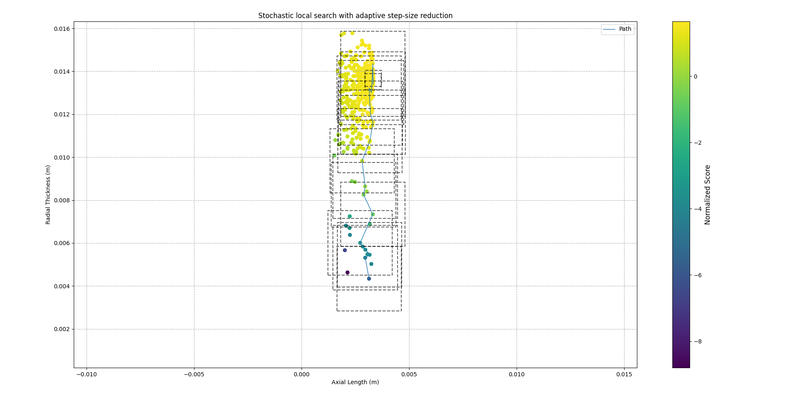

### 01_run_300um_wire_6_slots

<div align="center">
  
  <br>
  <em>Normalized Trace.</em>
</div>

<br>

This search run used 300 µm (0.3 mm) diameter wire and 6 slots, with the rest of the parameters fixed according to the
`parameters.uiv` file. The objective function was maximized:

```py
# A, -B, C, -A, B, -C
for index in range(0, self.number_slots):
    # Selects the slots phase and polarity
    phase = phases[index % 3]
    polarity = -1 if index % 2 == 0 else 1
```

#### High-Level

```
objective(fixed_params, slot_thickness, slot_axial_length) = force + force_per_amp + force_per_second - 2 * copper_losses
```

#### Normalization

```
[optimizer.normalization]
average_force: 10 (N)
force_per_ampere: 30 (N/A)
force_per_second: 50 k(N/s)
copper_loss: 40 (W)
```

---

### Implementation

```py
# Normalizes the evaluation function
normalized_F = average_force / parameters.optimizer.normalization.average_force
normalized_F_A = force_per_amp / parameters.optimizer.normalization.force_per_ampere
normalized_F_S = force_per_second / parameters.optimizer.normalization.force_per_second
normalized_losses = losses / parameters.optimizer.normalization.copper_loss
normalized = normalized_F + normalized_F_S + normalized_F_A - 2 * normalized_losses
```

```py
if normalized > best_normalized:
    # Updates the best normalized & drops the stall
    best_normalized = normalized
    stall = 0

    # Saves the best outputs & inputs
    best_force = average_force
    best_force_per_amp = force_per_amp
    best_force_per_second = force_per_second
    best_losses = losses

    best_slot_axial_length = axial
    best_slot_thickness = thickness
    continue
```

---