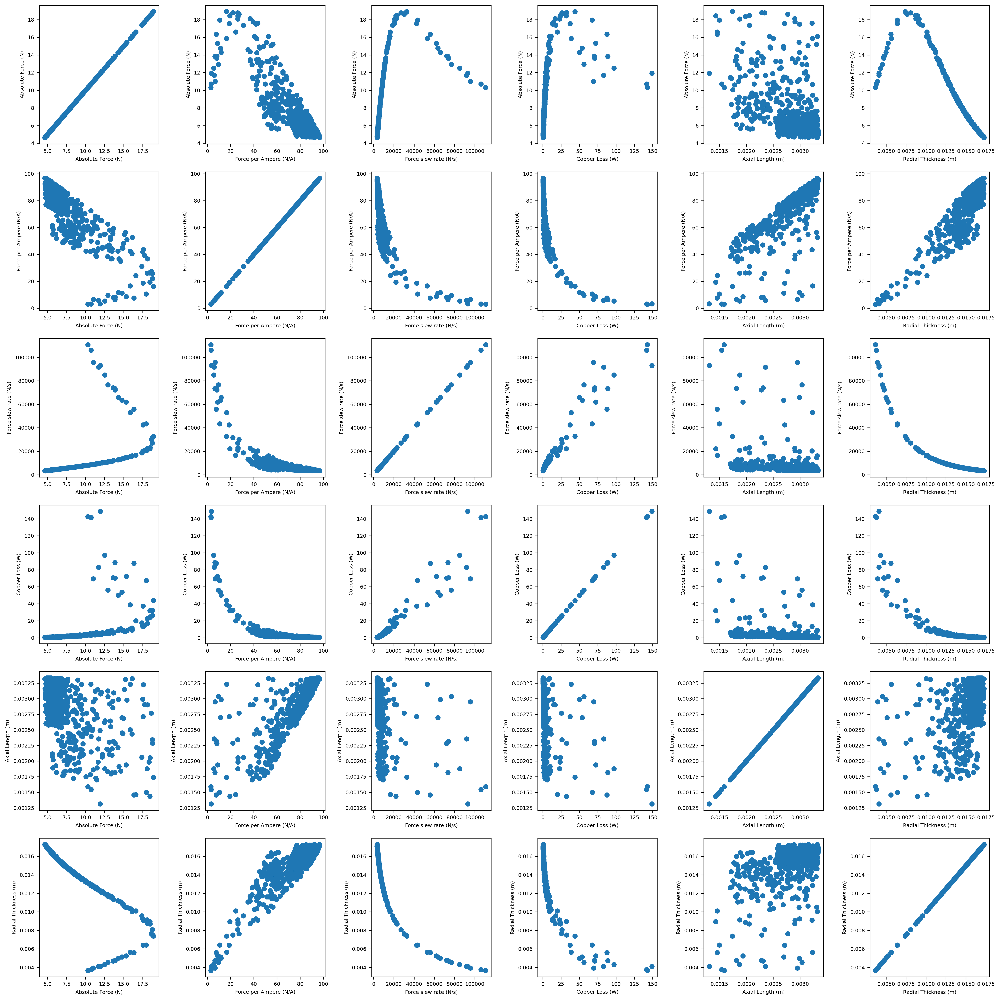

<div align="center">
  
  <br>
  <em>Trade offs for 18 slot 300um wire diameter motor.</em>
</div>


### Search/Optimization


> For optimization within a deterministic mode, differences between results are often more informative than absolute values.
> Do not assume the resulting absolute value is correct and/or will function identically in reality.

The optimizer is a form of stochastic local search with adaptive step-size reduction. It searches for better slot thickness 
and wire diameters within fixed wire size, voltage, pole size, and other secondary parameters. It searches for designs that 
have high force, high force per ampere, high force per second while also having low copper losses (the first-order loss mechanism for ironless motors).

```
objective(_, thickness, axial_length)= n_force + n_force_per_amp + n_force_per_second - 2 * n_copper_losses
```

<br>

Stochastic (random) search was chosen as the parameter size is small (`N^2`) and because the design space is known to contain valid designs, 
and OpenLSM doesn't need the best possible motor within the design space. It is a reasonable choice given those conditions.

```
# Note: These only applies for `optimizer.py`.
[optimizer]
stall_max: 100 (∅)
samples: 10000 (∅)

[optimizer.size]
start: 1.5 m(m)
min: 0.1 m(m)

[optimizer.normalization]
copper_loss: 40 (W)
force_per_ampere: 10 (N/A)
```

> `optimizer.size` defines the step size of the optimizer which is the same for both axial and thickness.

---