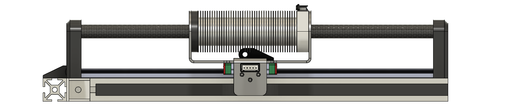

### 02_motors

#### [00_prototype_alpha](./00_prototype_alpha) - Ironless Planar Linear Motor

Prototype Alpha is an `ironless planar linear motor` with a polylactic acid (PLA) armature featuring `6` slots, hand wound using `0.2 mm` diameter enameled copper wire and `5 mm` wide Kapton tape, with `2` slots in-series per phase (WYE). The stator, similar to the armature, was printed in PLA and had `4` pole pairs per armature length and `10` pole pairs total.

    
     
    <em>Prototype Alpha. Side view on test stand without encoder wiring.</em>

 

---

#### [01_prototype_beta](./01_prototype_beta) - Ironless Tubular Linear Motor

Prototype Beta is an `ironless tubular linear motor` series; the first and second revisions are thermal management studies, with the third revision using strategies developed. The third revision is intended to be built and tested.

 
<em>Prototype Beta revision 2: Radial heat-sink design study (aluminum 6061, eddy current analysis).</em>

---
