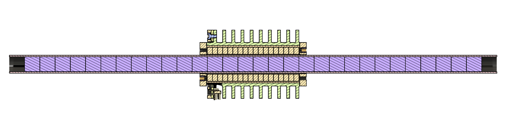

### 02_motors
---

#### [01_prototype_beta](./01_prototype_beta) - Ironless Tubular Linear Motor

An `ironless tubular linear` motor featuring a passive radial `6061` annular heat sink potted around the enameled copper slots. Due to the low electrical frequency of ~`65 Hz` at a linear velocity of `650 mm/s`, eddy currents are a second-order effect compared to removing heat from the slots. The armature has `18 slots` of `0.3 mm` diameter enamelled wire, with `6` slots in series per phase. The stator is a carbon fibre tube with `10 mm × 10 mm N52` poles arranged as `(N-S|S-N)`. The motor is intended to be used with `12–24 V` supplies.

  

  <em>Cross-sectional analysis of armature & stator</em>

---

#### [00_prototype_alpha](./00_prototype_alpha) - Ironless Planar Linear Motor

Prototype Alpha is an `ironless planar linear motor` with a polylactic acid (PLA) armature featuring `6` slots, hand wound using `0.2 mm` diameter enameled copper wire and `5 mm` wide Kapton tape, with `2` slots in-series per phase (WYE). The stator, similar to the armature, was printed in PLA and had `4` pole pairs per armature length and `10` pole pairs total.

    
     
    <em>Prototype Alpha. Side view on test stand without encoder wiring.</em>

 

---
