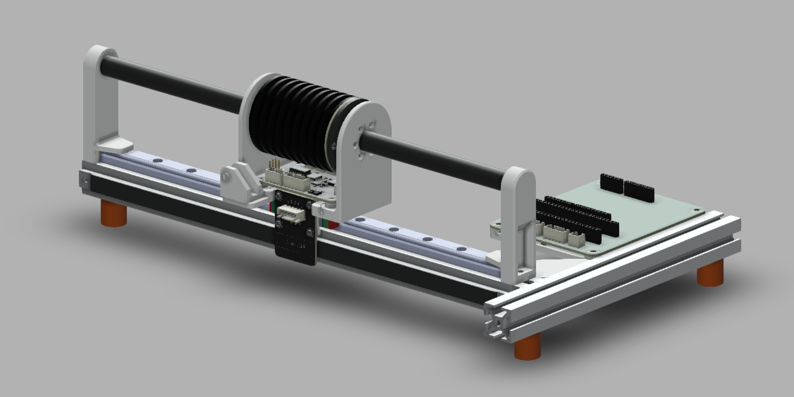

### 04_fixtures

#### [00_potting](./00_potting/) - Motor Potting

*(TBD) - Work in progress*

---

#### [01_validation_setup](./01_validation_setup/) - Validation / Experimental apparatus

The validation setup consists of a main board designed to collect position data from the magnetic linear encoder, as well as thermal and acceleration data from ICs on the board. It then sends that data over RS-485 to a Teensy 4.1, which controls the motor using a SimpleFOC shield while also logging the data.

  

---
