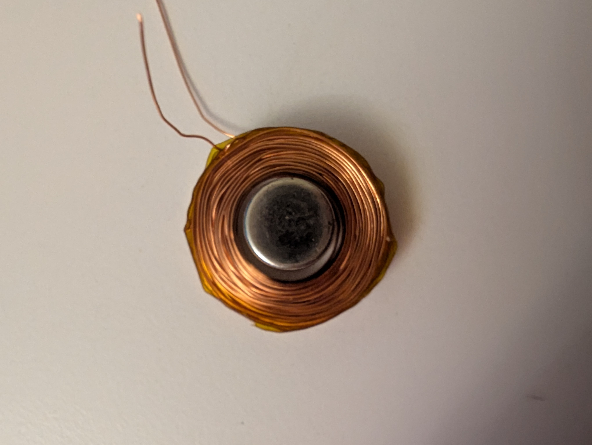
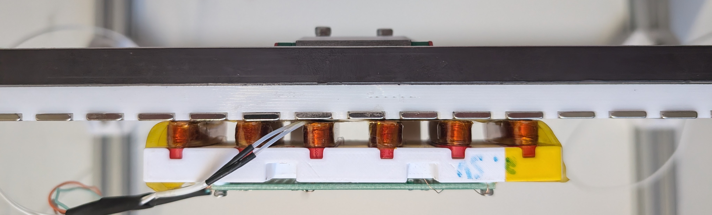
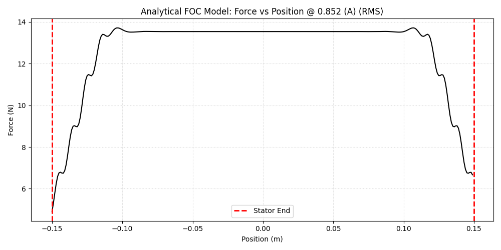
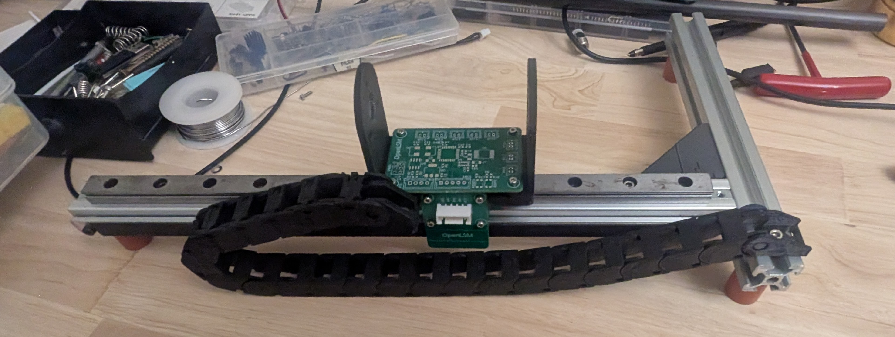
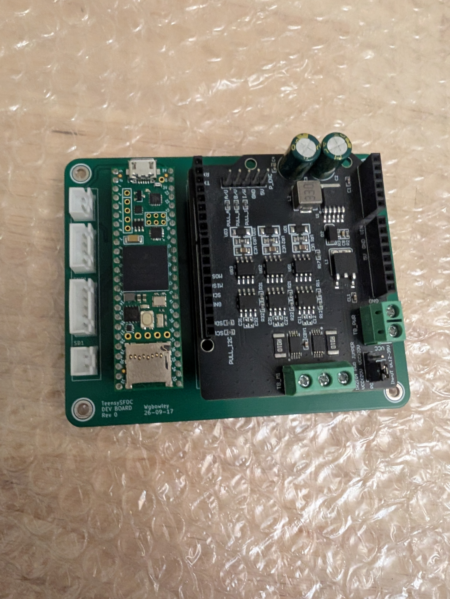

<!--
Color Palette:
FFFFFF - pure white 
FF8F0E - bold, warm orange with a strong golden-yellow undertone

I'm going to do a little experiment here and not update the logo
until someone raises an issue about light-mode readability.
- William Bowley, 2026-07-05

P.S: Thanks for downloading the OpenLSM repository `▽`ʃ♡
-->


<div align="center">
  
  
  Low-Cost Linear Synchronous Permanent-Magnet Motor <br>
</div>

### Overview

OpenLSM is an experimental project with the objective of designing low-cost permanent magnet linear motors for Cartesian motion systems such as pick-and-place machines or CNC machines. 
The project will fulfill this goal by using readily available materials and tooling, combined with analytical and hybrid models.

### Objectives

```
- [x] Support voltage bus ranges of `12 V_dc` and `24 V_dc`.
- [x] Validate the TeensySFOC and encoder board for linear motor applications.
- [/] Achieve a target force per amp of `3.0 N/A_rms` and positional accuracy of `50 µm`.
- [/] Reach an asymptote temperature of `60°C` under constant `5 N` static loading.
- [/] Validate motor performance and generate performance curves for each voltage range.
- [/] Scope a `Prototype Gamma` as an entry point for contributors to extend beyond OpenLSM.
```
> *(Note). `[/]` In progress. `[x]` Complete.*

---

### Beta

> *(Work in progress). The design is being implemented in CAD with a focus on heat sink development.*

An `ironless tubular linear` motor featuring a passive radial `6061` aluminium heat sink potted around the enameled copper slots. Due to the low electrical frequency of ~`65 Hz` at a linear velocity of `650 mm/s`, eddy currents are a second-order effect compared to removing heat from the slots. The armature has `18 slots` of `0.3 mm` diameter enamelled wire, with `6` slots in series per phase. The stator is a carbon fibre tube with `10 mm × 10 mm N52` poles arranged as `(N-S|S-N)`. The motor is intended to be used with `12–24 V` supplies.

<div align="center">
  
  <br>
  <em>Single armature slot and single stator pole.</em>
</div>

<br>

See the [`motor design notes`](./02_motors/01_prototype_beta/rev_2/readme.md) for the full electromagnetic and thermal rationale of `Conceptual Design Rev 2`.

---

### Alpha

An `ironless planar linear` motor with a polylactic acid (PLA) armature featuring `6` slots, hand wound using `0.2 mm` diameter enameled copper wire and `5 mm` wide Kapton tape, with `2` slots in-series per phase `(WYE)`. The stator, similar to the armature, was printed in PLA and had `4` pole pairs per armature length and `10` pole pairs total. The motor produced measurable force, although the force output was not quantified before the PLA coil forms deformed due to thermal stress.

<div align="center">
  
  <br>
  <em>Side view on test stand.</em>
</div>

<br>

The main conclusion from Prototype Alpha is that `planar linear motors` likely require `laminated silicon steel` armatures to produce force efficiently. In response, Prototype Beta shifts to an `ironless tubular topology` with the goal of quantifying force output and thermal performance.

See the [`alpha notes`](./02_motors/00_prototype_alpha/readme.md) for the full report on Prototype Alpha.

---

### Numerical Methods

#### Simulation

This analytical model uses inverse Clarke and Park transforms to compute the phase current based on position, 
then uses 1D field approximations to compute the magnetic co-energy, and finally uses its spatial derivative over the z-axis to compute force.

<div align="center">
  
  <p><em>1D field approximation and FOC showing position (linear) vs force (linear).</em></p>
</div>

<br>

See [`01_simulation`](./01_simulation/readme.md) for more details.

#### Stochastic Search

*(work in progress).*

---
 
### Supporting Boards

#### Validation Stand & Sensors

> *(On-hand). The armature board rev 1 PCB is on-hand. Components will be ordered from DigiKey soon.*

The integrated sensor boards are a platform for measuring the motor's position, acceleration, and thermal profile `T(z, t)`. 
The system consists of two boards: an encoder board with a resolution of `1.96 µm` and estimated accuracy of `10–20 µm`,
and a sensor board featuring a thermistor array, `3-axis` SPI accelerometer, encoder interface, and `RS-485/RS-422` output, 
all collected via an `STM32`.

<div align="center">
  
  <p><em>Validation stand with populated encoder and bare revision 1 armature board.</em></p>
</div>

#### TeensySFOC

The TeensySFOC board is a breakout board for the Teensy 4.1 and SimpleFOC Arduino shield with `step/dir` input. 
It is a development board that is not intended for long-term usage.

<div align="center">
  
  <p><em>Populated TeensySFOC PCB.</em></p>
</div>

<br>

See [`03_boards`](./03_boards/) for the supporting PCB and [`04_fixtures`](./04_fixtures/) for validation setup.

---

### Documentation

Each section of the repo is self-documenting.  
For internal documentation, credits, and contributors, refer to [`00_docs`](./00_docs/).

#### Dropped

This folder contains items that were attempted but dropped, as they were determined to not serve the critical path of the project.

```
00 - 96 V, 30 A triple half-bridge driver.
01 - Hybrid model between FEMM and Biot–Savart
```

See [`06_dropped`](./06_dropped/) for more details.

#### Bibtex

```
@misc{openLSM_2026,
  author = {William Bowley},
  title = {openLSM: Low-Cost Linear Synchronous Permanent-Magnet Motor Platform},
  url = {https://github.com/wgbowley/openLSM},
  year = {2026},
  note = {GitHub repository},
  license = {MIT}
}
```

---
